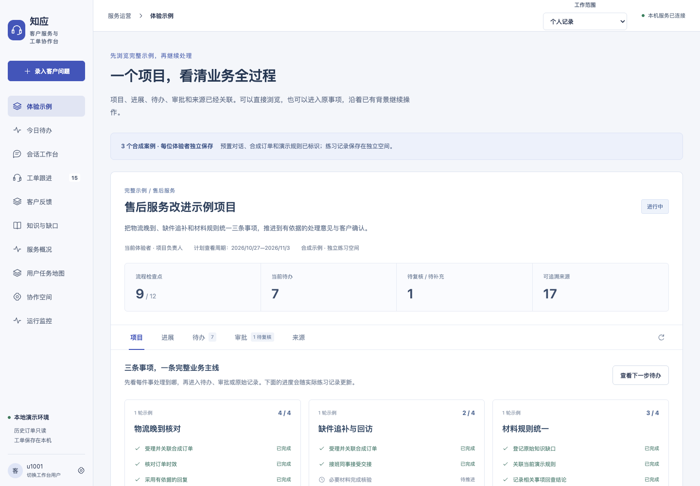
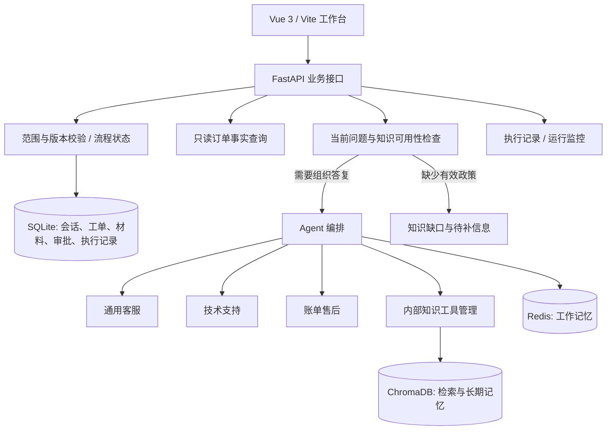

# 知应 · 客户服务与工单协作台

**从一条客户投诉，走到有依据、有人接手、可以追踪的处理结果。**

知应是一个面向客服受理、回复准备、工单跟进与知识维护的个人改造项目。它将客户原话、只读订单、回复依据、材料、待办、审批和客户结果关联到同一事项，支持在已有背景上继续处理。

[浏览产品案例](http://47.76.25.13/portfolio/zhiying.html) · [用户任务地图](docs/task-map.json) · [架构说明](docs/architecture.md) · [验收与已知问题](docs/acceptance.md) · [本地运行](#本地运行)

> 项目定位：基于既有 EchoMind Python / Vue 工程持续改造的本地产品原型。本人主导问题定义、产品取舍与反馈，使用 AI 辅助实现、走查与文档整理。尚未完成真实客服访谈、生产接入或外部用户效果验证。完整工程暂以私有仓库保存，原工程来源与许可边界见 [NOTICE](NOTICE.md)。



## 为什么做这个产品

一段流畅的答复，不能回答所有业务问题：它引用了哪条规则？下一步由谁处理？上一班核对了哪些材料？审批通过后客户是否真的解决了问题？

知应围绕这些问题，把“生成回复”放进可继续办理的工作流：

| 业务断点 | 产品行为 | 完成标准 |
| --- | --- | --- |
| 接班需要重新阅读所有对话 | 同一事项关联订单、材料、交接和下一步 | 接班人能沿用已有核对结果继续处理 |
| 模型把测试规则当成正式政策 | 测试 / 业务模式与知识审核状态分开 | 正式承诺能追溯到当前生效规则 |
| 写完答复就被视为解决 | 草稿采用、内部完成与客户结果分别记录 | 能说明做了什么、客户是否确认、还有什么待办 |
| 故障恢复后仍沿用旧问题 | 当前补充覆盖旧状态，保留复发分支 | Agent 按当前问题分工，避免多派或漏派 |
| 数据看起来漂亮但不可解释 | 直接查询、知识工具、Agent 执行分别记录 | 记录能回到关联会话，未调用不会伪装成执行成功 |

这些需求来自业务推演、实际软件中的 Agent 情境走查与回归检查，不是已经完成的用户研究。任务频率、优先级和业务价值仍待真实使用验证。

## 用户与任务地图

地图包含 **4 类角色、6 个业务阶段、31 项任务与 13 个场景**。这是设计范围，不是全部已实现的功能数量。

| 角色 | 要完成的工作 | 需要交付的结果 |
| --- | --- | --- |
| 当班客服 | 受理、核对、准备答复、安排后续 | 可追溯答复和明确下一步 |
| 接班同事 | 接受交接，延续原事项 | 上下文连续，材料与责任可核对 |
| 主管 | 发现漏单、积压与待复核事项 | 可解释的分派与处理结果 |
| 知识维护人员 | 收到缺口，补齐并审核规则 | 当前生效的业务依据与回查记录 |

业务阶段：**开始当班 → 受理与核对 → 准备回复 → 分派与跟进 → 结案与重开 → 复盘与补齐**。

每项任务记录触发、输入、步骤、输出、完成条件、异常出口、当前支持和剩余缺口，再连接用户故事、场景与验收依据。完整结构见 [task-map.json](docs/task-map.json)，设计方法见 [任务地图说明](docs/task-map-guide.md)。

## 核心流程与产品能力

### 从完整示例继续办理

系统内置物流晚到、缺件追补、材料规则统一三条合成案例。项目概览关联进展、待办、审批和来源，可以直接浏览，再回到原事项继续对话；新建一轮保留旧记录。

推荐体验缺件案例：

1. 打开「体验示例」，浏览售后改进项目。
2. 进入「缺件投诉：接班后补齐材料」，阅读原话、材料与交接历史。
3. 核对尚未补齐的数量说明，记录下一步、负责人和期限。
4. 在草稿中区分客户自述、订单事实和演示规则，核对后本地采用。
5. 材料与内部方案完成后，单独记录本轮客户结果；重新投诉时在原事项重开。

完整产品目前运行在本地。公开作品集中的流程交互是讲解，不会调用模型或操作真实工单。

### 回复有依据，缺口有出口

- 订单事实走只读查询，明确的时效核对直接计算，不必调用意图或回复模型。
- 外语评价保留原文与来源，机器译文用于辅助阅读，不能推断客户未表达的事实或企业政策。
- 回复草稿、客服参考、客户原话和内部备注分开；本地采用不表示已通过真实渠道发送。
- 测试资料与正式业务知识分开，草稿、审核与生效版本分别管理。
- 缺少政策时登记知识缺口并回到原事项；不靠模型补出退款、税费或赔付承诺。

### 交接、材料和结案连在一起

- 工单记录负责人、期限、优先级和下一步，今日待办用于发现到期与未分派工作。
- 交接需要接受或退回，变更后的材料清单不能用旧版本静默确认。
- 材料核验、内部审批、客户结果分别记录；凭证失效和重开都有后续出口。
- 服务端版本校验拒绝旧记录覆盖新版本；未提交编辑在本浏览器按用户、范围和事项恢复。
- 本地成员切换支持协作演练，**不等同于企业认证与安全隔离**。

### Agent 执行可解释

通用客服、技术支持和账单售后按当前问题分工；复合问题可分派多个领域。没有政策依据时允许主动不调用回复 Agent。

监控区分：

| 指标 | 代表什么 | 不能代表什么 |
| --- | --- | --- |
| 助手执行记录 | 接入记录后的执行请求，可跨重启保留 | 全部历史请求或计费账单 |
| 本次启动 Agent 执行 | 当前服务进程中各 Agent 的执行累计 | 跨重启累计、Token 数或内容正确率 |
| `knowledge_search` | 经过该知识工具的调用次数 | 所有数据读取、缓存译文或模型调用 |
| 已完成 | 执行流程返回结果 | 答复事实正确、客户确认解决 |

原工程 `mcp/` 是内部工具管理模块名称，本仓库不据此宣称外部 MCP 协议互通。

## 系统架构



SQLite 承载业务记录，Redis 与 ChromaDB 不替代工单业务状态。知识选择还需核对范围、审核状态和生效版本。详细链路、状态边界和工程入口见 [架构说明](docs/architecture.md)。

## 数据与示例的区别

| 内容 | 来源 | 用途与限制 |
| --- | --- | --- |
| Olist 历史订单与评价 | Kaggle 公开匿名数据，2016—2018 年 | 只读事实与历史评价练习，不是实时订单 |
| 机器译文 | 原评价的辅助翻译 | 保留原文和日期，准确性需人工核对 |
| 完整项目与三条案例 | 合成客户、订单与演示规则 | 解释流程，不是生产案例或企业政策 |
| Agent 验收输入 | 明确标记的合成任务 | 检查分派与来源忠实性，不代表外部客户结果 |

Olist 采用 CC BY-NC-SA 4.0；详细来源、货币口径、许可和导入边界见 [数据说明](docs/data-and-sources.md)。仓库不包含原始数据集、密钥、私人业务数据库或上传附件。

## 验证结果与已知问题

### 本次可复核结果

- **2026-10-28 自动化复跑：310 项后端测试通过，前端生产构建通过。** 包含已有用例，不是 310 条完整用户旅程。
- **2026-10-27 实际界面走查：9 类 Agent 情境。** 操作前记录预期，通过浏览器办理，再核对监控与只读数据库。
- 实际记录 **11 次编排执行、15 次 Agent 执行**，包括修复前与复验；技术 6、通用 2、账单 7，不可混作独立场景数或模型计费请求数。
- 该轮实际执行记录中失败和部分完成均为 0；超时、部分失败和备用执行的故障分支主要通过隔离受控测试验证。

### 内容未通过项仍然保留

| 场景 | 执行层结果 | 内容问题 | 当前结论 |
| --- | --- | --- | --- |
| AR02：已发货退货退款 | 账单 Agent 执行完成 | 来源只说明退货先于退款，答复却扩写为退货后才能提交退款申请 | 内容未通过 |
| AR03：重复扣款与 401 崩溃 | 技术与账单均执行 | 出现原问题没有的 301 和来源未覆盖的退款方式 | 内容未通过 |
| AR04：技术故障已恢复 | 曾多派技术，修复后只派账单 | 当前状态必须覆盖旧关键词；复发时重新识别 | 路由修复后界面复验通过 |

**调用成功率不作为回答正确率。** 下一步优先固定流程顺序、错误码原样保留和缺失规则不扩写的内容断言，再用实际界面复验。

[逐场景验收摘要](docs/evidence/acceptance.json) · [本次回归摘要](docs/evidence/regression.txt) · [验收方法与局限](docs/acceptance.md)

## 本地运行

当前工程是本地原型，默认只监听环回地址。公开作品集静态页面可独立浏览，无需模型密钥。

### 前置条件

- Python 3.11 或 3.12；当前工作副本的依赖快照见 `backend/requirements.local.lock.txt`。
- Node.js 20.19+ 或 22.12+，以及 npm。
- Redis 7+，仅绑定 `127.0.0.1:6387`。
- 支持 Anthropic 兼容 Messages 协议的模型服务，配置自己的 Key、URL 和模型名称。
- ChromaDB 默认本地模式；默认嵌入模型首次使用可能下载。也支持单独配置兼容嵌入接口。

### 启动后端

在一个终端中运行 Redis：

```bash
mkdir -p .runtime/redis
redis-server --bind 127.0.0.1 --port 6387 --protected-mode yes \
  --dir "$PWD/.runtime/redis" --appendonly yes
```

在另一个终端中安装依赖、配置并启动 API：

```bash
cd backend
python3 -m venv .venv
source .venv/bin/activate
python -m pip install -r requirements.txt
cp .env.example .env
# 编辑 .env，填写自己的模型 API Key、兼容接口地址与模型名称。
# 嵌入配置留空时使用 Chroma 默认本地模型；与已有集合维度必须一致。
python -m uvicorn api.main:app --host 127.0.0.1 --port 8010
```

本地服务会尝试配置的 Chroma HTTP 地址；不可用时回退到 `CHROMA_PERSIST_DIRECTORY` 本地目录。初次启动没有 Olist 历史数据，但仍可从合成完整示例浏览流程。模型服务需可用，不能把静态讲解误作离线完整产品。

### 启动前端

```bash
cd frontend
npm ci
npm run dev
```

- 工作台：`http://127.0.0.1:5175/`
- API 文档：`http://127.0.0.1:8010/docs`
- Vite 将 `/api/python` 代理到 `127.0.0.1:8010`。
- 从「体验示例」开始，无需导入私人资料。不要把开发服务直接暴露到公网。

### 运行检查

```bash
# 在 backend 目录，使用已安装项目依赖的 Python 环境
python -m unittest discover -s tests

# 在 frontend 目录
npm run build

# 从仓库根目录核对发布文件范围与明显凭证模式
python3 scripts/check_release.py
```

以上测试与构建在原工作副本于 2026-10-28 复跑。仓库源码由该副本按清单整理，安装到另一台机器后的兼容性仍需复验，不声称已覆盖所有平台。

## 工程目录

```text
backend/
  api/             HTTP 接口与业务路由
  core/            会话、任务、订单、知识、交接与状态规则
  agents/          领域 Agent 与编排
  mcp/             原工程内部工具与知识管理
  memory/          工作记忆与长期记忆
  monitor/         运行指标
  evaluation/      原工程评测器
  skills/          领域规范与提示
  tests/           回归测试
frontend/
  src/             Vue 页面、组件与样式
  public/          静态资源
docs/
  architecture.md  技术链路与边界
  acceptance.md    验收方法、结果与已知缺口
  task-map-guide.md 任务地图与需求追踪方法
  task-map.json    当前工程导出的任务目录
  data-and-sources.md 数据来源与复现限制
  images/          实际产品截图
  evidence/        不含私人记录的验收摘要
showcase/          新增知应案例页面及专用资源
scripts/
  check_release.py 发布内容核对
NOTICE.md          原工程、AI 协作与许可说明
```

## 下一步

1. **内容忠实性：** 对退款流程关系、错误码与政策承诺建立固定断言，修复 AR02 / AR03 后重新走界面。
2. **真实业务研究：** 观察真实客服接班、材料追补与结案，修订角色、完成条件和任务优先级。
3. **受控业务接入：** 企业登录、权限隔离、真实渠道回执与订单平台写操作按需接入，不把本地成员切换当成上线权限体系。
4. **效果评估：** 有真实样本后再衡量漏跟进率、返工率、依据覆盖和客户确认完成情况；当前没有效率提升或成本节省结论。
